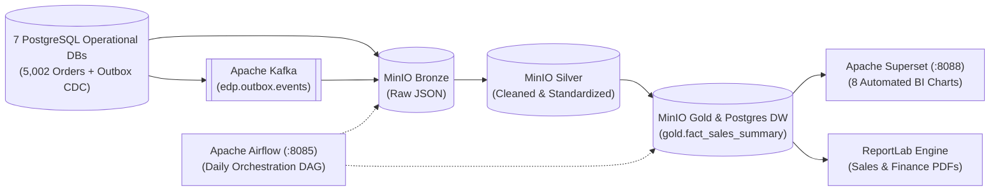

# Enterprise Data Platform (EDP) — End-to-End Medallion & Real-Time CDC Architecture

An end-to-end **Enterprise Data Platform (EDP)** combining **Real-Time Outbox CDC Streaming** (Apache Kafka) with a **Medallion Data Lakehouse** (`Bronze` -> `Silver` -> `Gold` on MinIO S3 & PostgreSQL Data Warehouse), orchestrated by **Apache Airflow** and visualized via **BI-as-Code** in **Apache Superset** and automated **ReportLab PDF Ledgers**.

## System Architecture



## Key Highlights & Benchmarks
- **7 Isolated Operational DBs:** Simulating enterprise microservices (`ecommerce_db`, `billing_db`, etc.).
- **High-Speed Bulk Processing:** Injected and processed **5,002 corporate orders & invoices** (**1,292,065,701 EGP** total volume) in `< 1.5 seconds` using `psycopg2.extras.execute_batch`.
- **Real-Time Streaming:** Captures database events via Transactional Outbox Pattern into **Apache Kafka**.
- **BI-as-Code:** Programmatically provisions an 8-chart Executive Dashboard inside **Apache Superset**.
- **Automated PDF Ledgers:** Generates print-ready departmental PDF reports for Sales and Finance/AR.

## Quick Start
```bash
# 1. Start all Docker containers
docker compose up -d

# 2. Run the Master Orchestrator
python run_platform.py
```

## Author
**Mohamed Elkalaf** — Data & BI Analyst | Python Backend & Data Analytics Engineer
